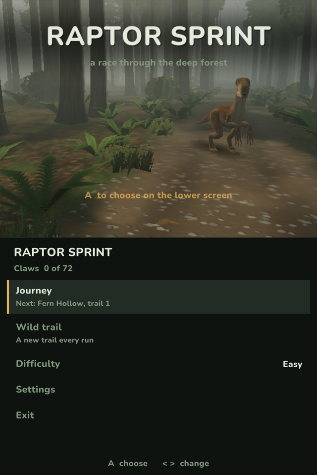
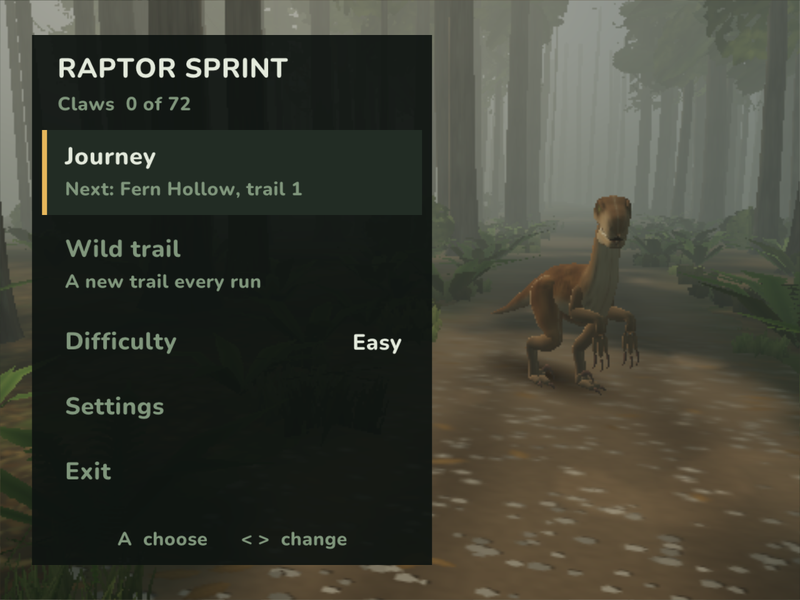
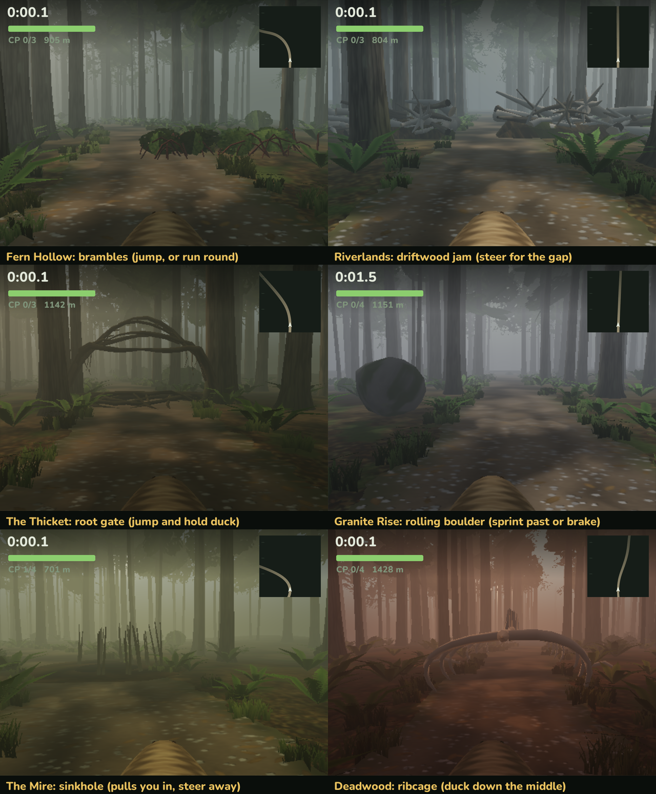

# Raptor Sprint

A first-person race through a prehistoric forest as a velociraptor, written in C++ with raylib for
handhelds. It runs on the RG DS (both screens), the RG34XXSP and the XU Mini M, and on a Mac
for development.

| Two screens (RG DS) | One screen |
|---|---|
|  |  |

Run six regions of four trails, or a new wild trail every time. Leap, duck, swerve and sprint past
logs, creeks, mud, falling trees and rolling boulders, and earn up to three claws on each trail.



## Difficulty

| | Speed | Obstacles |
|---|---|---|
| Easy | Base | Base |
| Normal | +10% | +20% |
| Hard | +20% | +50% |

Each difficulty keeps its own best times and claws. Finishing a trail at any difficulty opens the next.

## Controls

| Action | Handheld | Keyboard |
|---|---|---|
| Steer | D-pad or left stick | Left / Right |
| Jump | A | Space or X |
| Duck | B | Z or C |
| Sprint | R | Shift |
| Brake | Down | Down |
| Pause | Start | Esc or P |
| Choose in menus | A | Enter, Space or X |
| Back in menus | B | Backspace or Z |

Five clean moves in a row win back 20% breath.

## Building

```bash
scripts/build.sh mac
```

The handheld build needs an aarch64 Linux cross compiler (SDL2 and raylib are in `third_party`). Set
`CROSS` to its prefix if it isn't `aarch64-unknown-linux-gnu-` on your `PATH`:

```bash
CROSS=/path/to/bin/aarch64-unknown-linux-gnu- scripts/build.sh device
```

## Installing on a handheld

```bash
scripts/package-rocknix.sh
ROCKNIX_KEY=~/.ssh/your_key scripts/deploy-rocknix.sh DEVICE_IP
```

```bash
scripts/package-muos.sh
MUOS_KEY=~/.ssh/your_key scripts/deploy-muos.sh DEVICE_IP
```

The packaging scripts build first, so set `CROSS` as above if you need it. Close the game on the
device first: the scripts don't check. Saves are kept.

## Testing

`tests/course_test.cpp` generates trails and has the autopilot run them at every difficulty, checking
that each obstacle can be cleared and that each trail has the right number of obstacles.

## License

Raptor Sprint is open source. You are welcome to use, modify and share it, including commercially,
as long as you give credit.

- Source code and scripts: [MIT License](LICENSE)
- Screenshots and documentation: [CC BY 4.0](LICENSE-ASSETS)

Credit the project as:

> Raptor Sprint by omerkot — https://github.com/omerkot/raptor-sprint

All models, textures and sound are generated by the game's own code. Bundled third-party components
keep their own licenses:

| Component | License |
|---|---|
| [raylib](https://www.raylib.com) (`third_party/raylib`) | zlib/libpng, `third_party/raylib/LICENSE` |
| [SDL2](https://www.libsdl.org) (`third_party/sdl2`) | zlib, `third_party/sdl2/LICENSE.txt` |
| Nunito font (`assets/fonts/`) | SIL Open Font License, `assets/fonts/Nunito-OFL.txt` |
